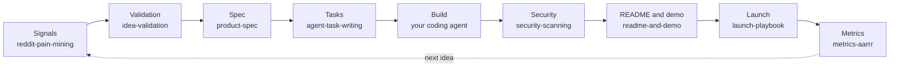

# product-factory-skills

Eight Agent Skills for taking a product from idea to launch with coding agents. Each skill is one
`SKILL.md` folder: plain instructions, a cited method, and an exit check. They work in Claude Code,
Antigravity, Codex, Copilot and Cursor.

## The skills

| Skill | What it does | When it triggers |
|---|---|---|
| `reddit-pain-mining` | Turns public complaints into quoted, linked, classified pain-point signals | Collecting idea signals from Reddit, Hacker News, Product Hunt, GitHub, review sites |
| `idea-validation` | Scores ideas with a weighted rubric (Mom Test evidence rules) and decides Build, Consider or Skip | Turning signals into a go or no-go decision |
| `product-spec` | Writes a PR/FAQ, a Shape Up pitch, then a PRD with Gherkin acceptance criteria | Speccing an idea you have decided to build |
| `agent-task-writing` | Writes self-contained task files a coding agent can finish, one issue each | Breaking a plan into work for Jules, Copilot, Claude Code or Antigravity |
| `security-scanning` | Layers free scanners (Gitleaks, TruffleHog, OSV-Scanner, zizmor) and gives triage rules | Checking a repo for leaked keys, vulnerable dependencies, unsafe workflows |
| `readme-and-demo` | Writes a README in the awesome-readme pattern and scripts a demo GIF and MP4 | A project is ready to release |
| `launch-playbook` | Drafts launches that follow each community's written rules (Show HN, Reddit, Product Hunt, GitHub) | Planning or drafting a public launch |
| `metrics-aarrr` | Sets a north-star metric, one AARRR metric per stage, and kill or continue rules | Setting up or reviewing product metrics |

## Install

**Claude Code**

```
/plugin marketplace add Naresh23032003/product-factory-skills
/plugin install product-factory@product-factory
```

**Antigravity**: copy `plugins/product-factory/skills/<name>` into `<workspace>/.agents/skills/`,
or into `~/.gemini/antigravity/skills/` to use it in every workspace.

**Other Agent Skills tools (Codex, Copilot, Cursor)**: copy the same skill folder into the tool's
skills directory.

## How the skills fit together



You can use any skill on its own. Each one ends with a list of the sources its method comes from.

## Contributing

Issues and pull requests are welcome. Keep a skill focused on one job, cite real sources, and keep
the `description` front matter under 300 characters and clear about when the skill applies. Run
`python3 scripts/validate.py` before opening a PR; CI runs the same check.

## License

MIT. See [LICENSE](LICENSE).
